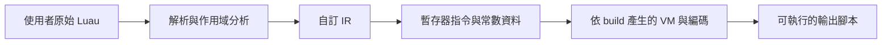
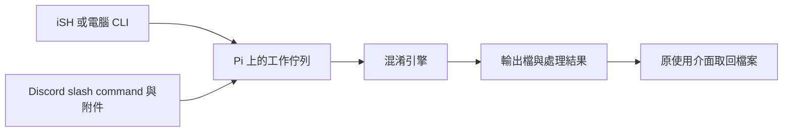

# 注入器端 Lua／Luau VM 混淆：第一輪研究

查核日期：2026-11-10。

## 已確認的目標

使用者要開發工具，保護自己寫的 Roblox 注入器端 Lua／Luau 腳本；
過往曾被抄襲。這裡研究的是腳本的編譯、虛擬化與輸出保護。

尚待使用者提供注入器名稱與版本。現在不能宣稱某個方案已在該環境可用。
本文件為文獻與原始碼研究；沒有執行混淆器、相容性測試或效能測量。

## 先釐清執行環境

Luau 基於 Lua 5.1，但有自己的語法、型別系統與執行行為；Lua 5.1
工具宣稱「輸出 Lua」不代表能正確處理完整 Luau 輸入。
參考 [Luau 相容性](https://luau.org/compatibility/) 與
[Luau 語法](https://luau.org/syntax/)。

Roblox 官方文件指出，原生 `loadstring` 不能載入編譯後的 bytecode，
且預設停用。但這項原生限制不能直接推論到注入器提供的同名函式。
目標注入器若替換了 loader、環境或其他 API，需要獨立確認。
來源：[Roblox LuaGlobals](https://create.roblox.com/docs/reference/engine/globals/LuaGlobals)。

建議產物仍以「可直接執行的 Luau 原始碼，包含自訂 VM 與編碼資料」
作為起點，以降低對特定 loader 的依賴。這是設計建議，尚未實測。

## 已查到的主要開源參考

| 專案 | 已確認的用途 | 適合作為什麼參考 | 重要限制 |
|---|---|---|---|
| [Luau](https://github.com/luau-lang/luau) | 官方語言、解析器、編譯器與 VM | 語法與語意基準、編譯前端 | 原生 bytecode 有版本限制；不是長期不變的格式 |
| [Prometheus](https://github.com/prometheus-lua/Prometheus) | AST 混淆管線及 Vmify | 自訂暫存器指令、VM 生成及多階段處理 | README 只標示基本 Luau 支援；當前授權是自訂 Prometheus License |
| [IronBrew 2](https://github.com/Trollicus/ironbrew-2) | Lua 5.1 VM 混淆 | 虛擬化整體結構與測試案例 | 不是完整 Luau 方案；不能原樣當作 Roblox 相容性基準 |
| [Fiu](https://github.com/rce-incorporated/Fiu) | 用 Luau 解譯 Luau bytecode | 快速驗證 interpreter、host function 與 callback 相容性 | 解譯器本身不等於混淆器；仍需編譯器，而且有行為差異 |

### Prometheus 的原始碼確認

目前 Vmify 將 AST 降低為暫存器指令，再產生 Lua VM；不是只改變數名稱。
來源：[Vmify.lua](https://github.com/prometheus-lua/Prometheus/blob/a98c50165f2a53f6d765a82eee60dfea53803445/src/prometheus/steps/Vmify.lua)
及 [compiler.lua](https://github.com/prometheus-lua/Prometheus/blob/a98c50165f2a53f6d765a82eee60dfea53803445/src/prometheus/vm/compiler.lua)。

目前 Medium／Strong preset 都使用 Vmify，但層次組合不同；preset 的
強弱名稱不能取代我們自己的效能與相容性測試。
來源：[presets.lua](https://github.com/prometheus-lua/Prometheus/blob/a98c50165f2a53f6d765a82eee60dfea53803445/src/presets.lua)。

當前 [LICENSE](https://github.com/prometheus-lua/Prometheus/blob/a98c50165f2a53f6d765a82eee60dfea53803445/LICENSE)
含工具／服務署名與衍生作品要求，以及生成產物的例外；不能當成沒有
附加條件的標準 MIT。若採用其程式碼，需針對固定版本逐項核對條款。
Luau、IronBrew 2、Fiu 查核的版本均標示 MIT；各自的版權聲明仍需保留。

### Fiu 的相容性界線

Fiu 是 interpreter，編譯後的 code 需另行取得。它提供環境注入、
namecall 與 vector 設定；文件也記載 generalized iteration、thread
identity、錯誤處理等方面的差異。不能只測 `print()` 就宣布完整相容。
來源：[Fiu README](https://github.com/rce-incorporated/Fiu/blob/fa1983d39f11f2b650b871d7a2d4e3b4c3e4ef2b/README.md)。

此次 Luau 原始碼快照的 bytecode 預設目標為 13，支援範圍為 3–14，
另有 class 版本 100。Fiu README 列出 3–14，並明示不支援 100。
這只是宣告範圍相符，不是已經逐指令測試通過。
來源：[Bytecode.h](https://github.com/luau-lang/luau/blob/12a6ba75883272c79b66b59815efef4c574196f6/Common/include/Luau/Bytecode.h)。

## 可選路線與初步建議

| 路線 | 優勢 | 代價 | 判斷 |
|---|---|---|---|
| AST 改寫、重新命名、常數處理 | 容易建立基線，方便定位語意錯誤 | 原始控制結構仍較容易推回 | 適合作為第一個可測版本及低負擔模式 |
| 官方 compiler + Fiu 類 interpreter | 能較快驗證 Luau 語法與 VM 邊界 | 固定格式與公開 VM 易辨識，還要跟進 bytecode 版本 | 適合相容性原型，不應把封裝本身當作強保護 |
| AST → 自訂 IR → 自訂 VM | 可掌握指令格式、build 變化與保護範圍 | 前端、閉包、控制流及 runtime 都需要維護 | 建議作為長期工具方向 |

以下架構是本專案的設計推論，不是現成實作：



建議先把 VM 覆蓋到選定的核心函式，再測是否適合擴大到整份腳本。
每幀或高頻事件的熱路徑應分開測量。Luau 原生有多種編譯與呼叫最佳化；
在上面增加一層 interpreter，實際成本必須量測，不能預先承諾倍數。
參考：[Luau 效能設計](https://luau.org/performance/)。

## 相容性需要測什麼

| 類別 | 必測案例 |
|---|---|
| 語法 | type annotation、continue、複合賦值、if expression、字串插值；未支援的語法需明確報錯 |
| 作用域 | 區域變數遮蔽、遞迴、closure、共享且可變的 upvalue |
| 呼叫 | `...`、多回傳值、尾端 nil、巢狀呼叫、冒號方法及 self |
| 值與 table | nil／false 區別、稀疏陣列、metatable、userdata／Instance |
| 非同步 | coroutine yield／resume、task、事件 callback、跨 host function 的等待 |
| 錯誤 | pcall／xpcall、非字串錯誤物件、錯誤位置及堆疊資訊 |
| 環境 | 全域函式、目標注入器提供的 API、模組及環境查找規則 |

Luau 型別及語法處理應經過 parser；不建議用正規表示式直接剝除型別。
外部 API 先視為 host function 邊界，保留函式參數、回傳值、self、
userdata 與 yield 行為。等拿到實際執行器資料，再建立 adapter 與測試。

## 如何對應「被抄襲」問題

可把保護目標分成：提高閱讀／還原成本、隱藏原始結構，以及識別流出版本。
後續可評估自訂指令編碼、不同 build 的指令對應、常數處理與 VM 結構
變化；每一層都要測成本，不能以程式長度或編碼層數當作強度證明。

可加入不影響功能的 build 指紋／版本水印，並在開發端保存對照紀錄，
協助辨識外流版本。水印本身不等於不可移除，也不能單獨證明抄襲。

執行端同時持有 VM、資料及執行結果，因此 VM 混淆不能保證原碼永久
不可還原，也不適合拿來保存永久秘密。Roblox 官方對客戶端控制能力的
說明可作為這個威脅模型的參考，但不能據此推論特定注入器的 API。
來源：[Roblox 客戶端安全模型](https://create.roblox.com/docs/scripting/security/security-tactics)。

## 建議的第一階段成果

1. 明確列出目標注入器版本、輸入語法與外部 API。
2. 建立原版／處理後腳本的差異測試：輸出、狀態、錯誤與非同步順序。
3. 實作最小 parser／IR／VM 路徑，先通過函式、closure、vararg 與迴圈測試。
4. 在真實目標環境測載入時間、持續執行時間、記憶體及輸出大小。
5. 基線穩定後，再逐層加入編碼與 build 變化，保留可重現的失敗樣本。

CLI 介面草案（尚未建立這個指令）：

```text
luavm protect input.luau --out protected.luau --profile <目標環境>
```

沒有使用者腳本、目標執行器資料與實測前，不宣稱「完整 Luau 支援」、
「無效能損失」或「無法反混淆」。

## 使用介面與樹莓派部署

使用者希望完成一份 Lua 後，可以方便提交混淆；正在比較 Pi 操作與
Discord bot。兩者可共用同一個混淆引擎：Pi 是執行主機，bot 是收檔介面。

建議架構：



| 介面 | 操作構想 | 條件與資料流 |
|---|---|---|
| Pi CLI | 傳入 input.lua，再執行一個混淆命令 | 原碼可維持在自己的設備；遠端使用需能連到 Pi |
| Discord bot | `/obfuscate` 附上 Lua 檔，完成後回傳輸出檔 | Pi 保持開機上網；附件會經過 Discord 平台，不是全本機處理 |

建議先建立 CLI 及處理核心，確認腳本執行結果正確，再接私人 Discord bot。
這樣可保留純本機使用方式，也能在手機外出時透過 Discord 操作。
介面不改變混淆的保護強度，強度與相容性仍由編譯器及 VM 決定。

Discord 接法可採 Gateway，由 Pi 主動連上 Discord 的 WebSocket；
這種設計不需要對 Pi 開公開 HTTP 接收端點，也不需要為 bot 轉發路由器埠。
依據：[Discord Gateway](https://docs.discord.com/developers/events/gateway)。

Discord 支援 application command 的附件參數。建議私人 bot 僅接受
指定使用者 ID，收檔後排隊，先回覆處理中，再回傳結果；輸入只解析、
編譯與轉換，正式服務不直接執行上傳的原始腳本。加入檔案大小、執行
時間與同時工作數上限，避免一份失敗腳本拖住其他工作。
參考：[Application Commands](https://docs.discord.com/developers/interactions/application-commands)。

官方 interactions 有初始回覆與後續回覆時限；長工作需先 defer，
並設計可再次查詢的工作狀態。附件大小應依 interaction 提供的限制
處理，不把固定容量當作永久 API 規則。
參考：[Receiving and Responding](https://docs.discord.com/developers/interactions/receiving-and-responding)。

以上仍是介面與部署方案，尚未建立 Discord app、bot、工作佇列或混淆引擎。

## 查核的來源版本

| 專案 | branch | commit | commit UTC 日期 |
|---|---|---|---|
| Luau | master | `12a6ba75883272c79b66b59815efef4c574196f6` | 2026-11-07 |
| Prometheus | master | `a98c50165f2a53f6d765a82eee60dfea53803445` | 2026-11-09 |
| IronBrew 2 | master | `4063f3aa6b24d24c0d3ce44da55dbd9d591c2cfd` | 2023-09-21 |
| Fiu | main | `fa1983d39f11f2b650b871d7a2d4e3b4c3e4ef2b` | 2026-10-15 |

上述為查核時 GitHub API 回傳的 branch HEAD；未將第三方程式碼整合成
本專案依賴，也沒有執行它們。
